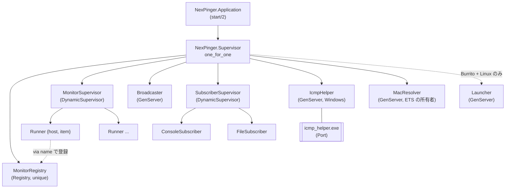
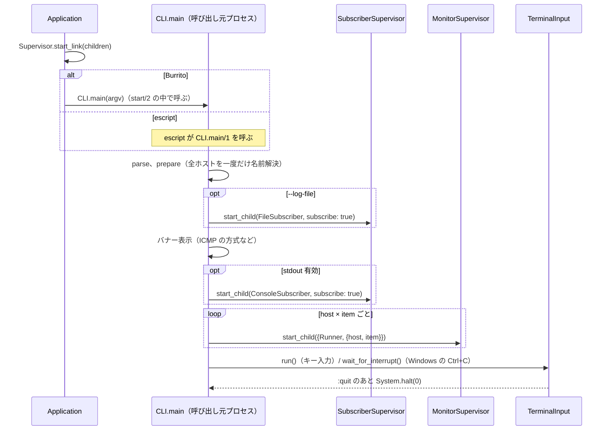
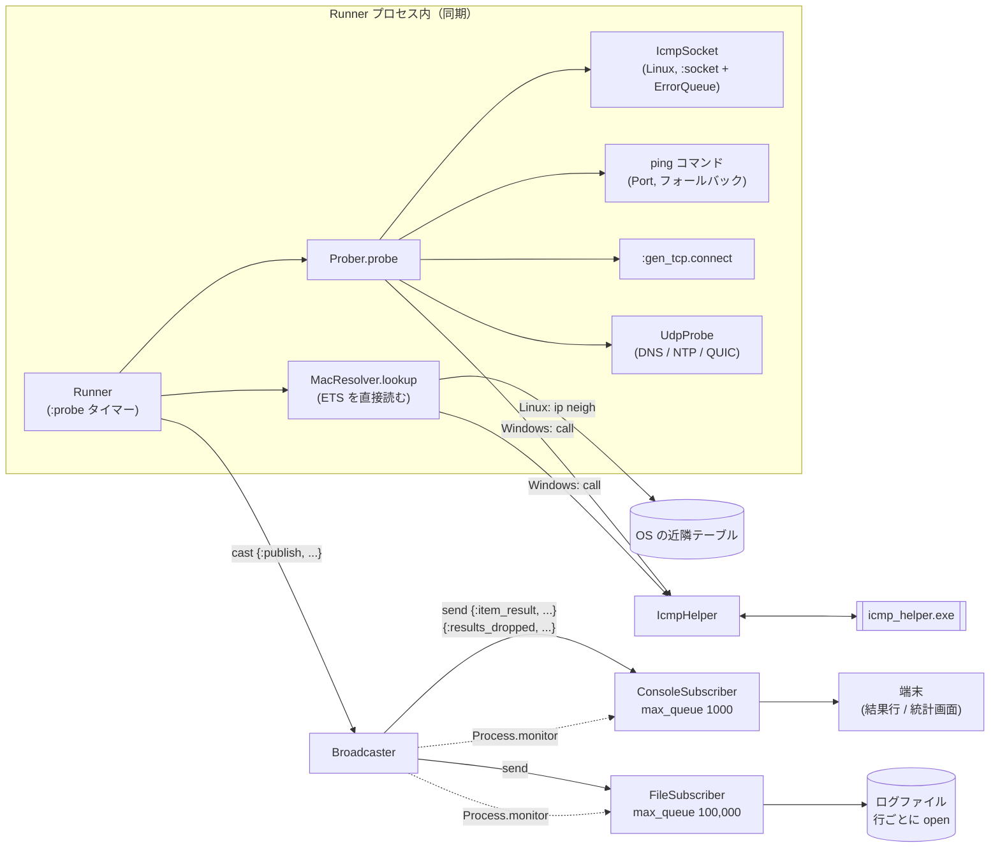
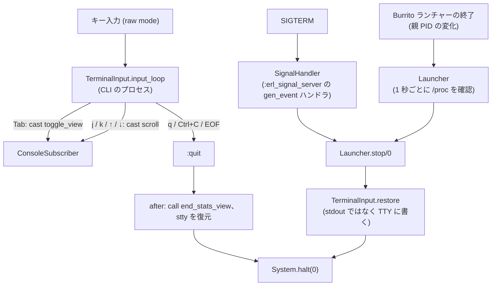

# アーキテクチャ

[English](architecture.md) | 日本語

NexPinger のプロセス構成と、プローブの結果が画面・ログファイルに届くまでの流れ。

## 監視ツリー

- `Broadcaster` は `SubscriberSupervisor` より先に起動する。Subscriber は `init` で subscribe するため
- 2 つの DynamicSupervisor は空で起動する。Subscriber と、項目ごとの `Runner` は CLI が追加する
- `Launcher` の追加と `SignalHandler` の差し替えは、Burrito かつ Linux のときだけ

## 起動

Subscriber を Runner より先に起動するので、最初の結果も取りこぼさない。CLI と `TerminalInput` は
監視下にない。呼び出し元のプロセス（Burrito では `Application.start/2` を実行しているプロセス）で動き、
戻らない。

## 結果の流れ

- `Prober` と `MacResolver.lookup` は `Runner` 自身のプロセスで動く。`MacResolver` のプロセスは
  ETS のキャッシュ（IP ごとに 15 秒）を持つだけ。他プロセスへの call は Windows の `IcmpHelper` だけ
- `Runner` はプローブや MAC 取得の失敗をクラッシュにせず NG の結果にする。クラッシュが続いて
  `MonitorSupervisor` が再起動の上限に達するのを防ぐため
- `Broadcaster` は `cast` で受けて `send` で配るので、プローブは出力を待たない。Subscriber ごとに
  `message_queue_len` を見て、上限に達したら結果を捨てて対象ごとに数える。半分まで減ったら
  `{:results_dropped, ...}` を送り、配信を再開する
- 再起動した Subscriber は pid が変わる。`Broadcaster` は `:DOWN` で古い pid を外し、新しいプロセスが
  自分で subscribe し直す（`subscribe: true`）

## キー入力と終了

- 通常の終了は CLI のプロセス内で完結し、`after` 節で端末を戻す
- SIGTERM とランチャーの終了は別プロセスから来る。保存済みの stty 設定と統計画面のフラグを
  `:persistent_term` から読み、stdout のパイプが壊れている場合に備えて TTY デバイスに書く

## プロセス一覧

| プロセス | 種別 | 個数 | 役割 | 主な相手 |
|---|---|---|---|---|
| `Runner` | GenServer | host × item ごと | 決まったスケジュールでプローブし、結果を publish | `Prober`（同一プロセス）、`Broadcaster` |
| `Broadcaster` | GenServer | 1 | 結果を Subscriber に配る。遅い相手の分は捨てる | Runner（受信）、Subscriber（送信・monitor） |
| `ConsoleSubscriber` | GenServer | 0 か 1 | 結果行と統計画面 | `Broadcaster`、`TerminalInput` |
| `FileSubscriber` | GenServer | 0 か 1 | text / tsv / jsonl のログファイル | `Broadcaster` |
| `IcmpHelper` | GenServer + Port | 1 | Windows の ICMP Echo と MAC 取得 | Runner（呼び出し元） |
| `MacResolver` | GenServer（ETS の所有者） | 1 | MAC の 15 秒キャッシュ | Runner が ETS を直接読む |
| `Launcher` | GenServer | 0 か 1 | Burrito ランチャーの終了時に BEAM を止める | — |
| `SignalHandler` | gen_event ハンドラ | 0 か 1 | SIGTERM で静かに終了 | — |
| `CLI` / `TerminalInput` | 普通の関数（呼び出し元プロセス） | 1 | 起動、キー入力、終了 | 各 Supervisor、`ConsoleSubscriber` |
