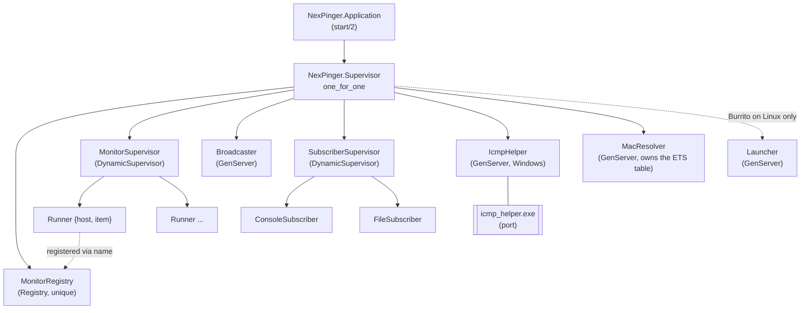
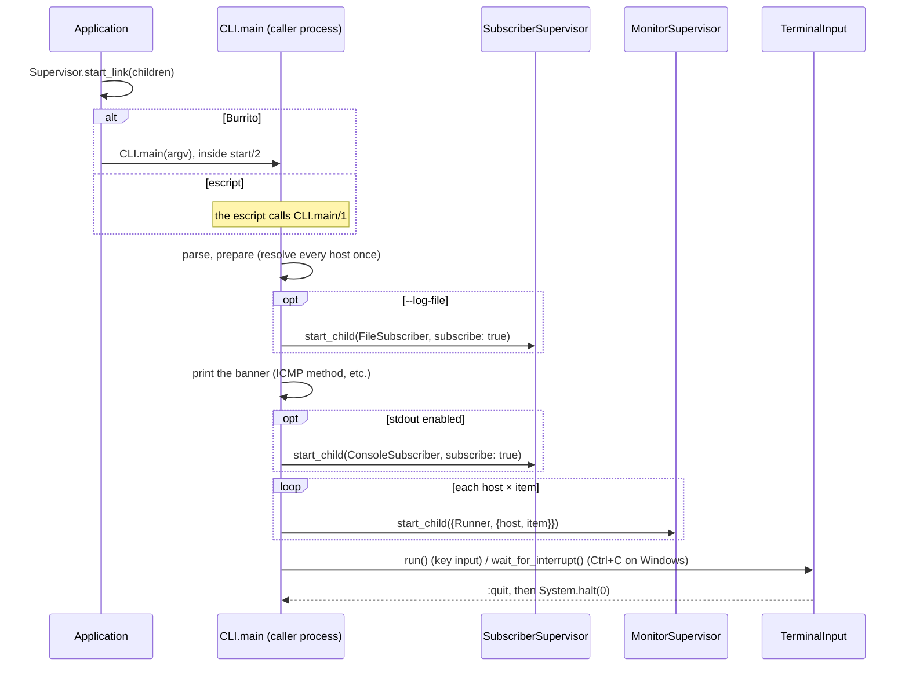
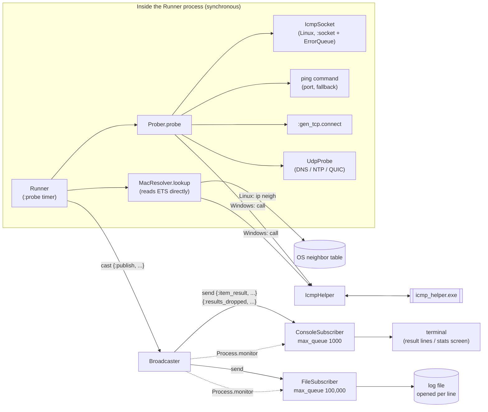
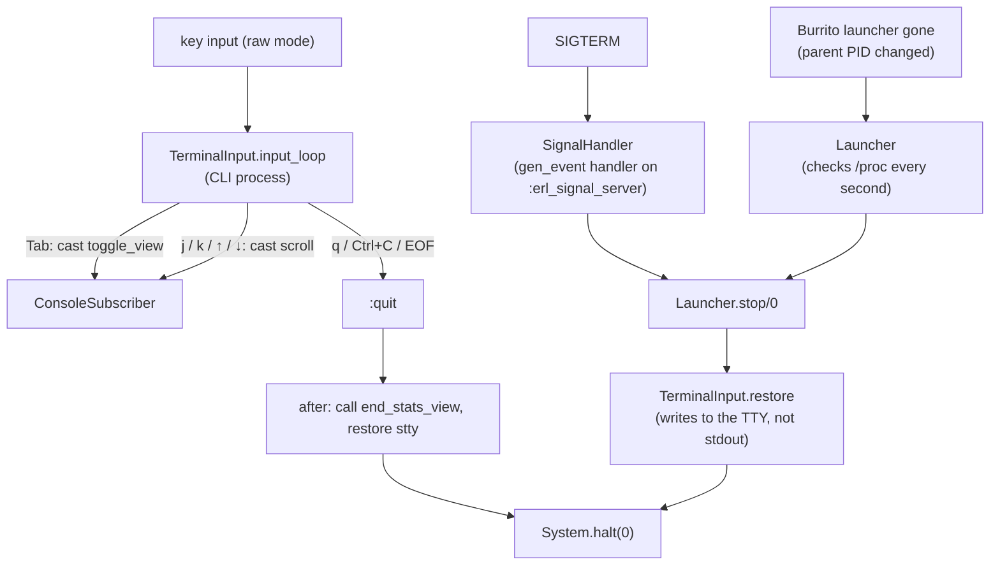

# Architecture

English | [日本語](architecture.ja.md)

How NexPinger's processes are laid out and how a result travels from a probe to the screen and the log file.

## Supervision tree

- The `Broadcaster` starts before `SubscriberSupervisor`: subscribers subscribe in their `init`.
- Both dynamic supervisors start empty. The CLI adds the subscribers and one `Runner` per item.
- `Launcher` is added, and `SignalHandler` installed, only under Burrito on Linux.

## Startup

Subscribers start before the runners, so the first results are not missed. The CLI and
`TerminalInput` are not supervised: they run in the calling process, which under Burrito is the
one running `Application.start/2`, and never return.

## Result flow

- `Prober` and `MacResolver.lookup` run in the `Runner`'s own process. The `MacResolver`
  process only owns the ETS cache (15 s per IP). The only call to another process is to
  `IcmpHelper`, on Windows.
- `Runner` turns any failure in a probe or a MAC lookup into an NG result rather than crashing,
  so repeated crashes cannot exhaust `MonitorSupervisor`.
- The `Broadcaster` takes results by `cast` and passes them on by `send`, so probes never wait
  for output. It checks each subscriber's `message_queue_len`: at the cap it drops and counts
  results per target; once the mailbox is down to half the cap, it sends
  `{:results_dropped, ...}` and then results again.
- A restarted subscriber has a new pid. The `Broadcaster` drops the old one on `:DOWN`, and the
  new one subscribes again itself (`subscribe: true`).
- A restarted `Broadcaster` has no subscribers (the supervisor is `one_for_one`, so the
  subscribers keep running). Subscribers subscribe with `Broadcaster.follow/1`, which also
  monitors the `Broadcaster`; on its `:DOWN` they subscribe to the new one, retrying every
  100 ms until it is registered. Results in the old one's mailbox are lost.

## Key input and exit

- A normal quit stays in the CLI process and restores the terminal in its `after` clauses.
- SIGTERM and a lost launcher come from other processes. They read the saved stty settings and
  the stats screen flag from `:persistent_term`, and write to the TTY device because the stdout
  pipe may be broken.

## Processes at a glance

| Process | Kind | Count | Role | Talks to |
|---|---|---|---|---|
| `Runner` | GenServer | one per host × item | Probes on a fixed schedule and publishes the result | `Prober` (in process), `Broadcaster` |
| `Broadcaster` | GenServer | 1 | Fans results out to subscribers; drops for slow ones | runners (in), subscribers (out, monitored) |
| `ConsoleSubscriber` | GenServer | 0 or 1 | Result lines and the stats screen | `Broadcaster`, `TerminalInput` |
| `FileSubscriber` | GenServer | 0 or 1 | Log file in text / tsv / jsonl | `Broadcaster` |
| `IcmpHelper` | GenServer + port | 1 | ICMP Echo and MAC lookup on Windows | runners (callers) |
| `MacResolver` | GenServer (ETS owner) | 1 | 15 s MAC cache | runners read the ETS table directly |
| `Launcher` | GenServer | 0 or 1 | Stops the BEAM when the Burrito launcher dies | — |
| `SignalHandler` | gen_event handler | 0 or 1 | Quiet exit on SIGTERM | — |
| `CLI` / `TerminalInput` | plain functions (caller process) | 1 | Startup, key input, exit | the supervisors, `ConsoleSubscriber` |
